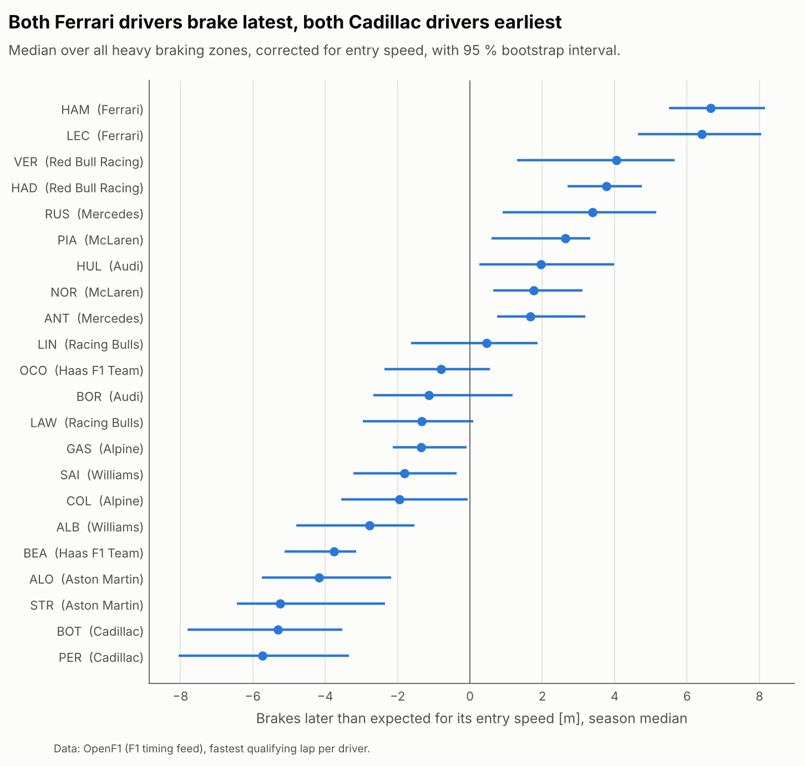
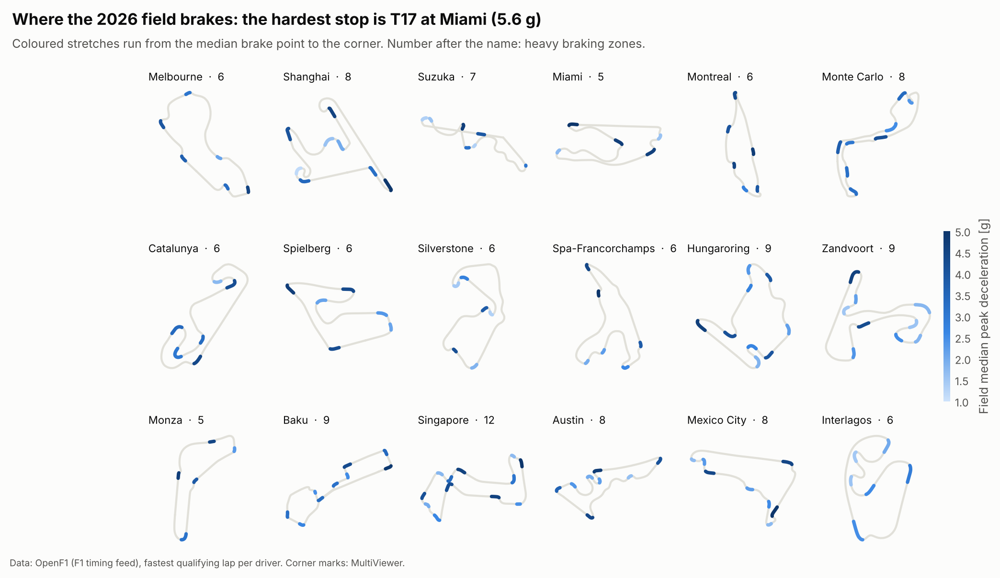
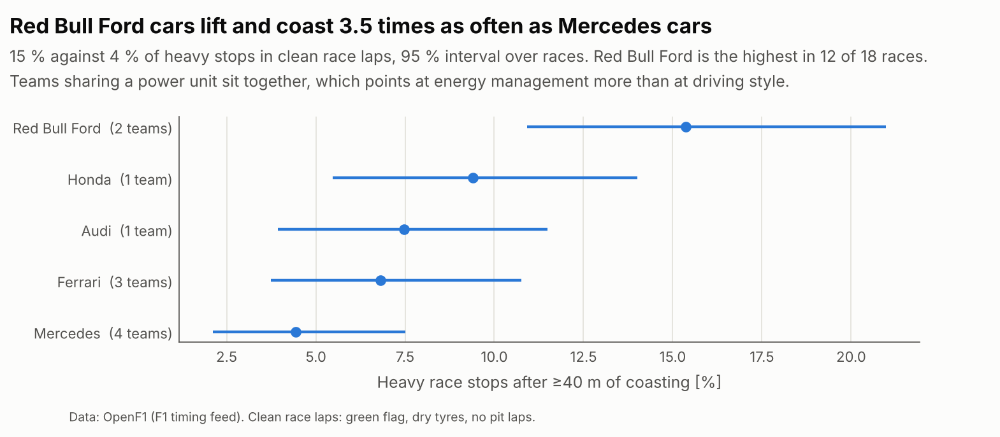

# brake-atlas


Braking analysis across the whole 2026 F1 grid. For each session I extract
every braking zone of every driver, match the zones to the official corner
numbers and compare drivers corner by corner: where they brake, how hard,
and how that changes from qualifying to the race.

It builds on [apex-trace](https://github.com/ncastrocajide/apex-trace), which
provides the lap model and the distance grid. apex-trace compares two laps;
this repo runs the same kind of comparison over 22 drivers and a season.

**Status:** 18 of the 20 rounds run so far, qualifying and race (the
other two have no official corner marks yet). Full
results in [docs/FINDINGS.md](docs/FINDINGS.md), the plan in
[docs/PLAN.md](docs/PLAN.md), and an interactive version in
[docs/index.html](docs/index.html) (pick a track and a corner).

## What came out

A single brake point is only known to about ±10 m, because the timing feed
is 4 Hz. Everything below is a median over many corners.

**The car sets the brake point, not the driver.** After correcting for
entry speed, driver medians vary 8 times more between teams than within a
team. Both Ferraris brake latest (+6.4 and +6.6 m), both Cadillacs earliest
(−5.3 and −5.7 m). Teammates are within about 2 m of each other in ten of
eleven teams; the exception is Hülkenberg, 5.1 m later than Bortoleto.



**The gaps between cars open at high speed.** McLaren is level with the
field in stops from below 250 km/h and 7.7 m later in stops from above
300 km/h; Cadillac goes from −3.7 to −10.0 m.



**On Sunday the field brakes about 14 m earlier** than in qualifying, same
driver and corner, even though it arrives 10 km/h slower.

**Lift and coast follows the power unit.** In clean race laps the two Red
Bull Ford teams coast 40 m or more before 15 % of heavy stops, the four
Mercedes powered teams before 4 %. Red Bull Ford is the highest in 12 of 18
races.



**Old tyres cost corner speed, not brake point.** Per 10 laps of tyre age
the minimum speed drops 0.5 km/h while the brake point does not move
earlier.

**Braking later gains a little.** Between teammates, the one braking 15 m
or more later is quicker through the corner 60 % of the time, by a median
of 21 ms.

## How it works

`detect_brake_zones` takes an apex-trace `Lap` and returns one `BrakeZone`
per braking event: brake point, release point, speed minimum, entry and
minimum speed, mean and peak deceleration in g, and the distance spent
coasting before the brake point. The feed only says whether the brake is on,
so deceleration comes from the speed trace (a = v dv/ds).

Each zone is tied to the first official corner after its brake point, and
the brake point is measured in metres before that corner on the lap's own
distance axis, so odometer drift between laps cancels. Drivers are compared
on the residual after fitting brake point against entry speed² at each
corner: a slower car can brake later without the driver doing anything.

Race laps are filtered before use: no first lap, no pit laps, no laps with
a yellow, red or safety-car message, dry tyres only, nothing slower than
105 % of the stint median, and no laps with holes in the telemetry. Of
21 400 race laps, 15 100 pass.

## Data

Since October 2026 the F1 timing archive (and so FastF1) only serves past
sessions to a signed-in F1 TV account. This repo reads the same car and
position feed from [OpenF1](https://openf1.org), which keeps past sessions
open, and the official corner positions from MultiViewer through FastF1's
client. Responses are cached in `.openf1_cache/`.

The feed sometimes freezes for a second or more (speed stops changing,
throttle and brake read 104). Those samples are dropped and any braking
zone that falls in the gap is left out, so a corner has data for 12-19 of
the 22 drivers, not all of them.

## Running it

```bash
uv sync
uv run pytest                                 # offline, synthetic data
uv run python examples/build_season.py        # qualifying: download + build
uv run python examples/build_races.py         # races: about 400 large requests
uv run python examples/season_atlas.py        # qualifying figures and numbers
uv run python examples/race_atlas.py          # race figures and numbers
uv run python examples/session_atlas.py Monza # one track
cd examples && uv run python export_atlas.py  # data for docs/index.html
```

## Roadmap

- [x] **M0**: repo, CI, braking-zone extractor with synthetic tests
- [x] **M1**: one qualifying session end to end, zone-to-corner matching,
      brake-point uncertainty, first heatmap
- [x] **M2**: season dataset, qualifying and clean race laps
- [x] **M3**: heatmaps and track maps for every round
- [x] **M4**: driver and teammate comparisons with intervals
- [x] **M5**: qualifying vs. race, tyres and fuel, lift and coast, speed bands
- [x] **M6**: findings write-up and interactive page
- [ ] Remaining rounds (Las Vegas, Lusail, Yas Marina), free-air filter for
      race laps, 2025 as a baseline for the regulation change

## Limitations

Car data arrives every 0.2-0.27 s, up to 20 m between samples at 300 km/h,
so single brake points are rough. There is no brake pressure or steering
channel, so nothing here is about trail braking. Qualifying uses one lap
per driver, the fastest, which mixes Q1, Q2 and Q3 track conditions. Race
laps are not filtered by gap to the car ahead yet. The Hungaroring race is
almost absent because of holes in the feed. Lift and coast is often a team
instruction, so I report it per team and power unit, not per driver.
