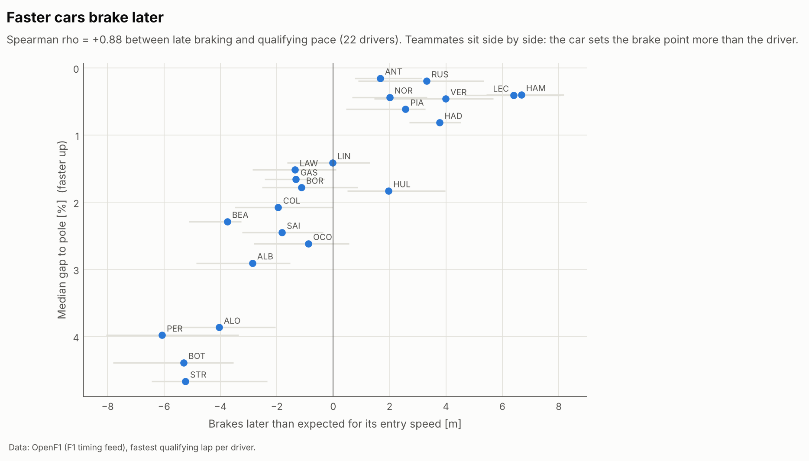
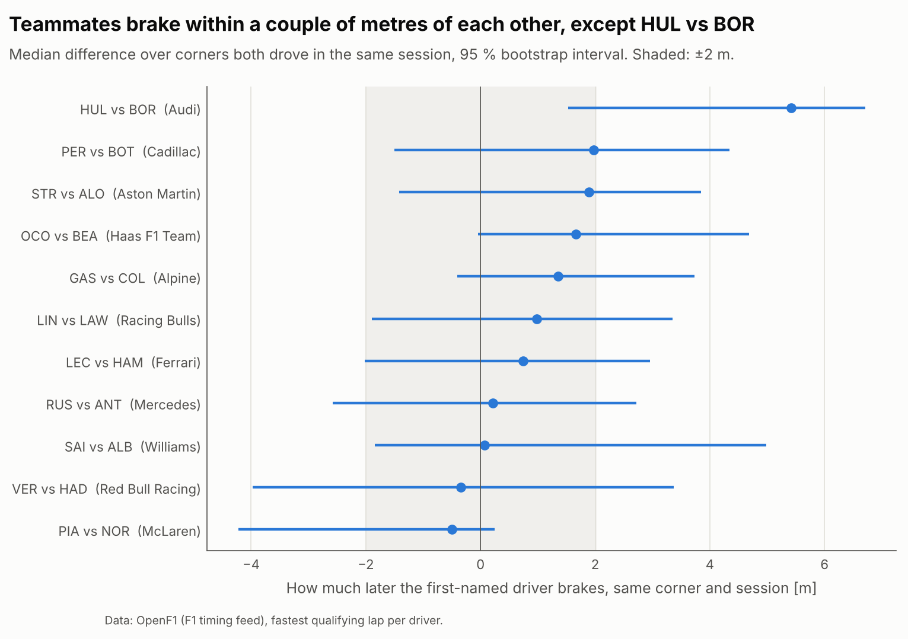
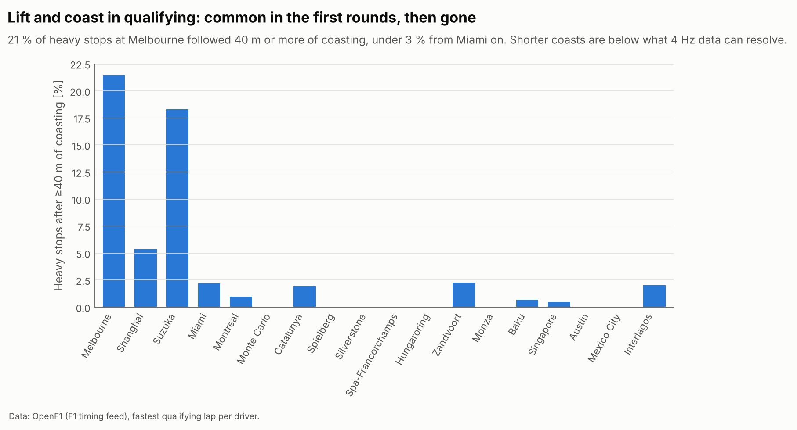
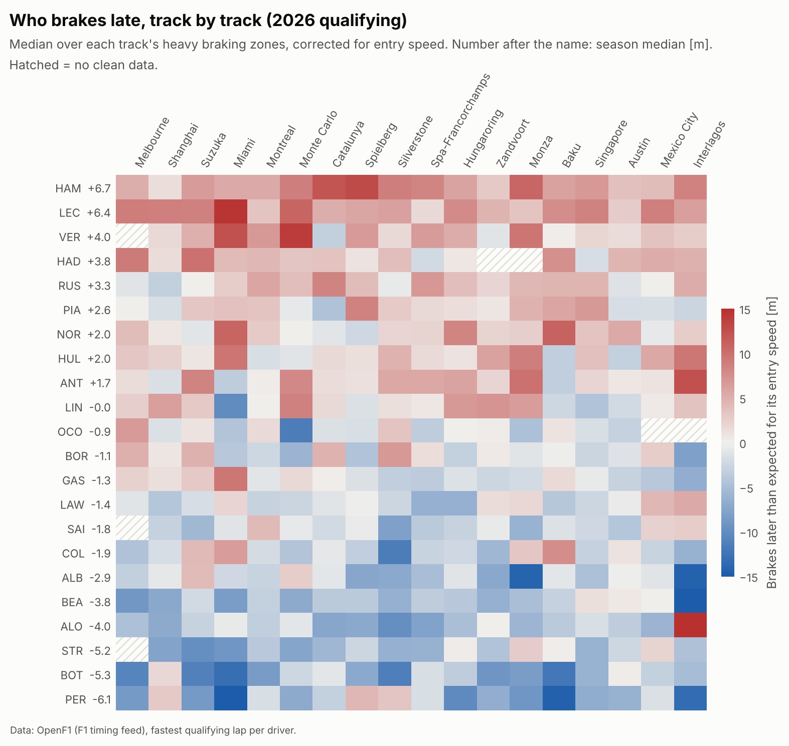
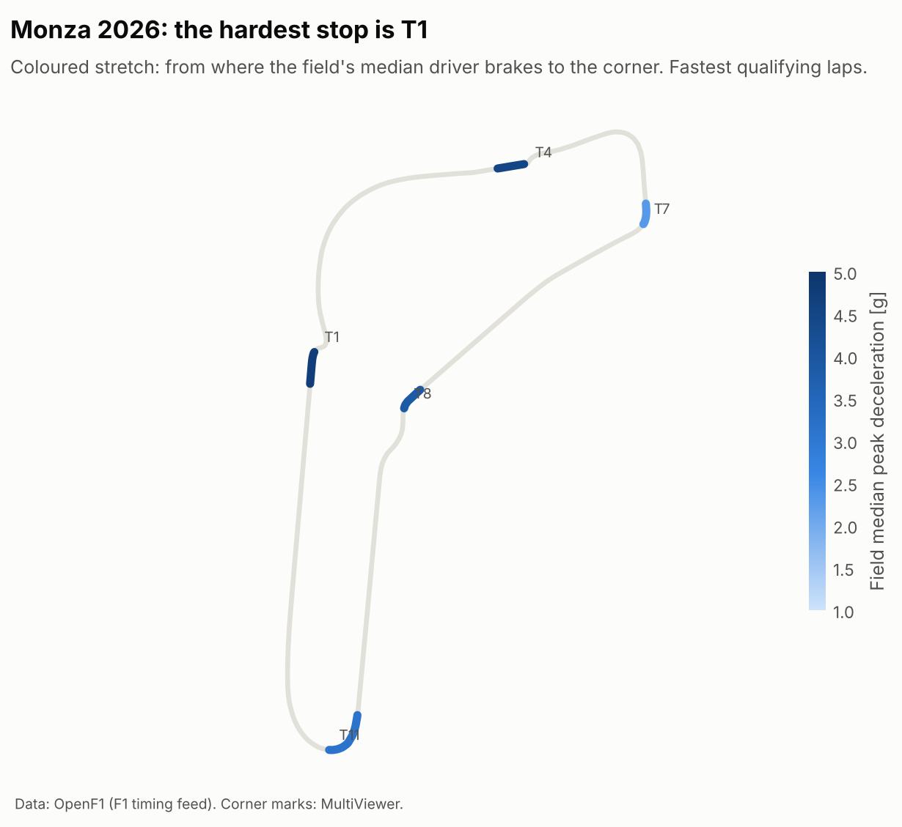
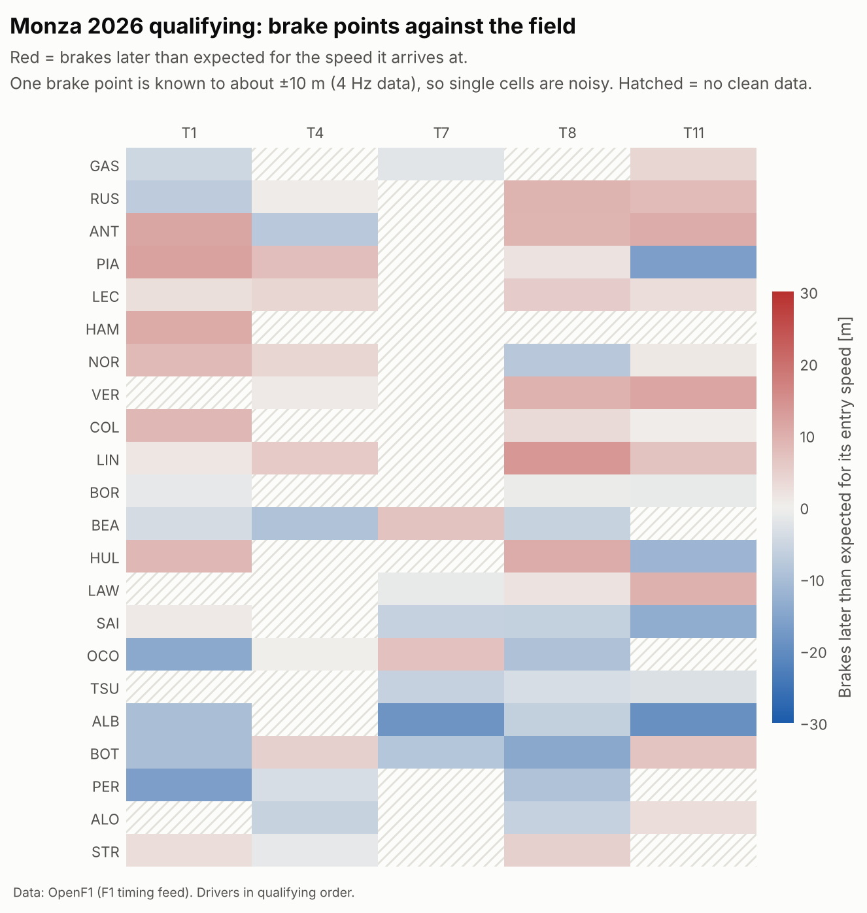

# brake-atlas


Braking analysis across the whole 2026 F1 grid. For each session I extract
every braking zone of every driver, match the zones to the official corner
numbers and compare drivers corner by corner: where they brake, how hard,
how much speed they keep to the apex and how much that changes from
qualifying to the race.

It builds on [apex-trace](https://github.com/ncastrocajide/apex-trace), which
does the lap loading, the distance grid and the corner marks. apex-trace
compares two laps; this repo runs the same kind of comparison over 22 drivers
and a full season.

**Status:** 2026 qualifying done for every round with usable data (18 of
22 so far). Race laps come next. The work plan is in
[docs/PLAN.md](docs/PLAN.md).

## Findings, 2026 qualifying

18 sessions from Melbourne to Interlagos (Bahrain and Jeddah were
cancelled; Madring and Kuala Lumpur have no official corner marks yet), the
fastest lap of each driver, 2030 heavy braking zones (speed drop of 50 km/h
or more). A single brake point is known to about ±10 m at 4 Hz, so
everything below is a median over many corners, never one corner.

Brake points are compared after correcting for entry speed. A car that
arrives slower can brake later without the driver doing anything special,
and the uncorrected numbers were misleading: at Monza they put the two
slowest cars at the top.


**The car sets the brake point, not the driver.** Over the season, driver
medians vary 9 times more between teams (12.5 m²) than within a team
(1.4 m²). Both Ferraris brake latest (+6.4 and +6.7 m against what their
entry speed predicts), both Cadillacs earliest (−5.3 and −6.1 m). Late
braking and qualifying pace go together (Spearman 0.88 over 22 drivers),
but the ranking sorts teams, with each pair of teammates next to each other.




**Teammates brake within about 2 m of each other, with one exception.**
Comparing both drivers on the same corner in the same session takes the
car, the track and the conditions out. Ten of eleven pairs come out within
±2 m, with intervals that include zero. Hülkenberg brakes 5.4 m later than
Bortoleto (95 % interval 1.5 to 6.7 m, 63 corners).



**Deceleration is aerodynamic.** The field's median peak deceleration is
4.7 g for stops that start above 300 km/h, 3.9 g from 250-300, 2.9 g from
200-250 and 1.8 g below 200 km/h: the grip goes with the downforce. The
hardest stop of the year is turn 17 in Miami at 5.6 g, and Miami also has
the biggest typical speed drop (199 km/h).

**Lift and coast in qualifying showed up early and then went away.** 21 %
of heavy stops at Melbourne and 18 % at Suzuka came after 40 m or more of
coasting, at the same corners for about ten drivers each. From Miami on it
stays under 3 %. That fits teams harvesting energy on the lap before they
learned to manage the new power units, but Melbourne and Suzuka only appear
once each, so a track effect cannot be ruled out yet. Coasts shorter than
about 40 m cannot be told apart from interpolation between 4 Hz samples.





One track in detail, Monza:





## What gets measured

`detect_brake_zones` takes an apex-trace `Lap` and returns one `BrakeZone`
per braking event, with brake point, release point and speed minimum (all in
metres from the line), entry and minimum speed, braking distance, mean and
peak deceleration in g, and the distance spent coasting before the brake
point. F1 timing only says whether the brake is on, so deceleration is
computed from the speed trace (a = v dv/ds).

The comparisons I want to get to:

- brake point relative to the field median at each corner, per track and
  over the season
- deceleration at equal entry speed and speed drop
- whether braking later costs minimum speed, driver by driver
- lap-to-lap spread of the brake point in clean race stints
- qualifying vs. race brake points, and how they drift with tyre age
- coasting before braking zones by team and power unit, which in 2026 is
  mostly about energy harvesting
- teammate comparisons, since that is the only way to take the car out

## Data

Since October 2026 the F1 timing archive (and so FastF1) only serves past
sessions to a signed-in F1 TV account. This repo reads the same car and
position feed from [OpenF1](https://openf1.org), which keeps past sessions
open, and the official corner positions from MultiViewer through FastF1's
client. Responses are cached in `.openf1_cache/`.

The feed has two problems the loader deals with. It sometimes freezes for a
second or two (speed stops changing, throttle and brake read 104); those
samples are dropped and any braking zone that falls in the gap is left out
rather than measured. And it only arrives at about 4 Hz, which is the main
limit on everything below.

## Running it

```bash
uv sync
uv run pytest                                 # offline, synthetic data
uv run python examples/build_season.py        # download + build (~20 min first time)
uv run python examples/season_atlas.py        # season figures and numbers
uv run python examples/session_atlas.py Monza # one track
```

## Roadmap

- [x] **M0**: repo, CI, braking-zone extractor with synthetic tests
- [x] **M1**: one qualifying session end to end, zone-to-corner matching,
      brake-point uncertainty, first heatmap
- [ ] **M2**: dataset builder for the season (qualifying done, clean race
      laps to do)
- [x] **M3**: heatmaps and track maps for every round
- [ ] **M4**: driver profiles and teammate comparisons (qualifying done)
- [ ] **M5**: tyre and fuel effects, qualifying vs. race, 2026 coasting,
      corner types
- [ ] **M6**: write-up of the findings and an interactive version

## Limitations

Car data comes in every 0.2-0.27 s, which at 300 km/h is up to 20 m between
samples, so single brake points are rough and the analysis leans on medians
over many corners. The feed also drops out for a second or more on most
laps; zones inside a dropout are left out, so each corner has data for
12-19 of the 22 drivers rather than all of them. There is no brake pressure
or steering channel, so trail braking can only be approximated. Only one
lap per driver and session is used so far, the fastest, which mixes Q1, Q2
and Q3 track conditions. And in 2026 coasting before a corner is often a
team instruction for energy management, so I treat it as a team pattern,
not a driver trait.
