# Findings, 2026 season so far

Data: 18 rounds from Melbourne to Interlagos. Bahrain and Jeddah were
cancelled; Madring and Kuala Lumpur have no official corner marks yet.
Qualifying uses each driver's fastest lap (2032 heavy braking zones).
Races use about 15 000 clean laps (green flag, dry tyres, no pit laps,
about 79 000 heavy zones). A heavy zone is a stop that loses 50 km/h or
more.

Two things to keep in mind throughout. A single brake point is only known
to about ±10 m, because the timing feed is 4 Hz, so every number here is a
median over many corners. And brake points are compared after correcting
for entry speed: a car that arrives slower can brake later without the
driver doing anything special. Before that correction the two slowest cars
on the grid came out as the latest brakers at Monza.

Every figure and number comes from `examples/season_atlas.py` and
`examples/race_atlas.py`.

## Qualifying

### The car sets the brake point

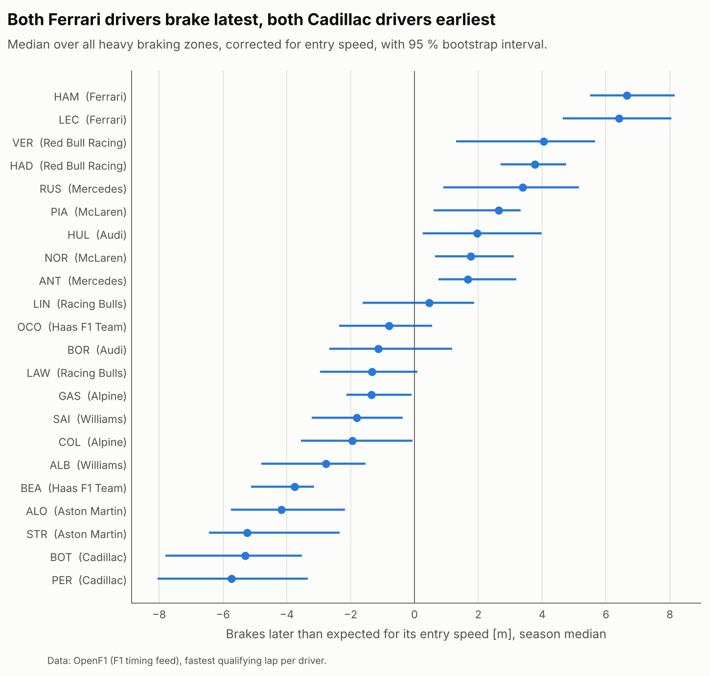

Driver medians vary 8 times more between teams (12.3 m²) than within a
team (1.5 m²). Both Ferraris brake latest, +6.4 and +6.6 m against what
their entry speed predicts, and both Cadillacs earliest, −5.3 and −5.7 m.
Late braking and qualifying pace go together (Spearman 0.87 over 22
drivers), but the ranking sorts teams, with teammates next to each other.

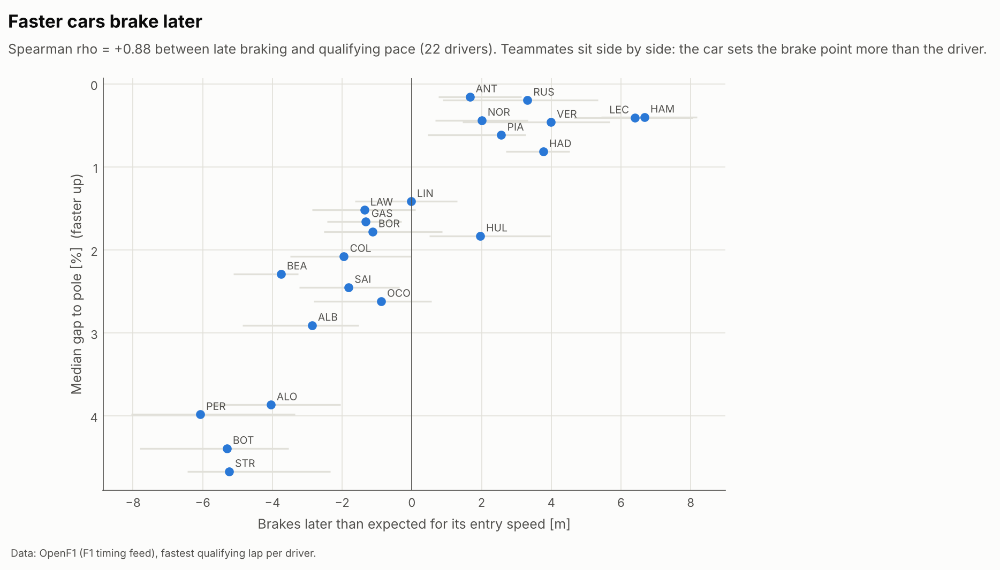

### The gaps between cars open at high speed

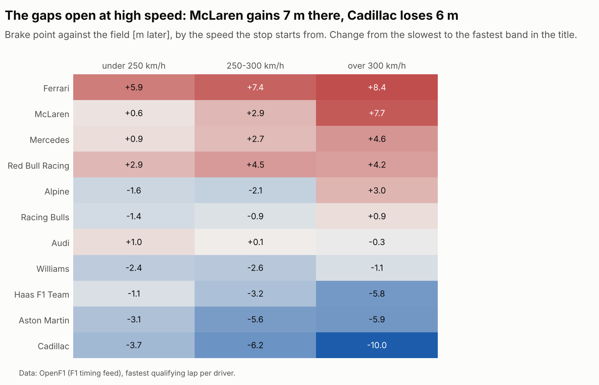

McLaren is level with the field in stops that start below 250 km/h (+0.6 m)
and 7.7 m later in stops from above 300 km/h. Cadillac goes the other way,
from −3.7 m to −10.0 m. Ferrari is late everywhere. Deceleration itself
follows speed: the field's median peak is 4.7 g above 300 km/h, 3.9 g from
250-300, 2.9 g from 200-250 and 1.8 g below 200 km/h. Both point at
downforce as what separates the cars under braking. The hardest stop of the
year is turn 17 in Miami at 5.6 g.

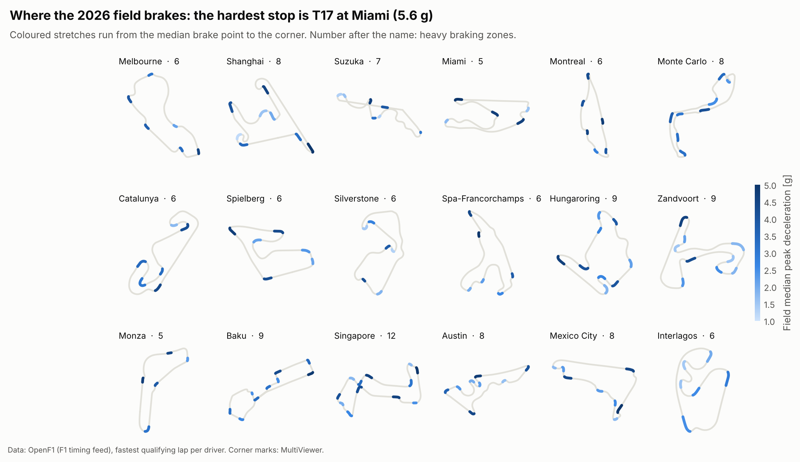

### Teammates brake within about 2 m of each other

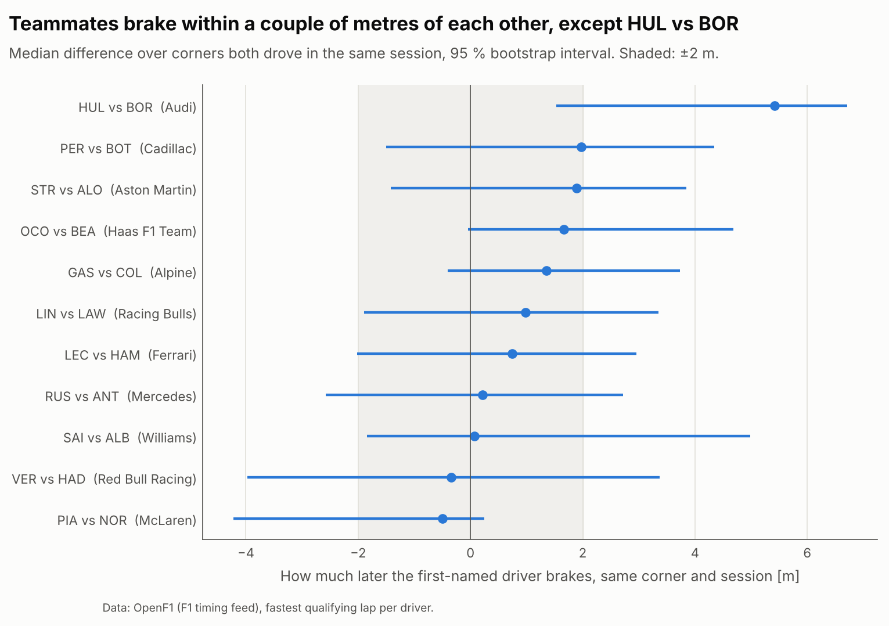

Comparing both drivers on the same corner in the same session takes the
car, the track and the conditions out. Ten of eleven pairs are within about
2 m with intervals that include zero. The exception is Audi: Hülkenberg
brakes 5.1 m later than Bortoleto (95 % interval 1.5 to 6.7 m, 63 corners).

### Braking later gains a little time

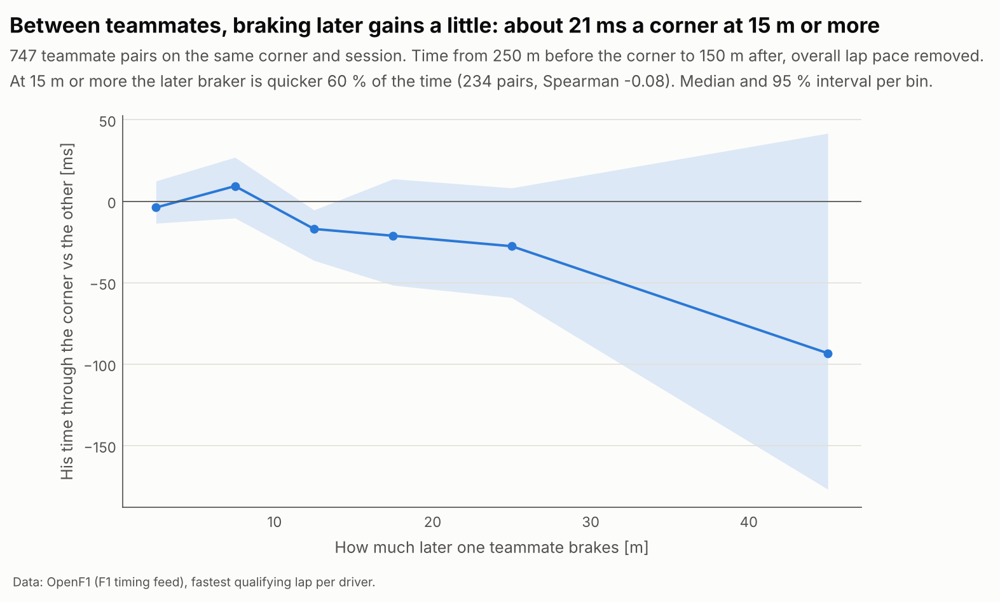

Among 747 teammate pairs, the one who brakes 15 m or more later is quicker
from 250 m before the corner to 150 m after it 60 % of the time, by a
median of 21 ms, after removing the difference in overall lap pace. The
correlation is weak (Spearman −0.08). With ±10 m of sampling error on each
brake point the true relation is probably stronger than what shows here,
but this is what the data supports.

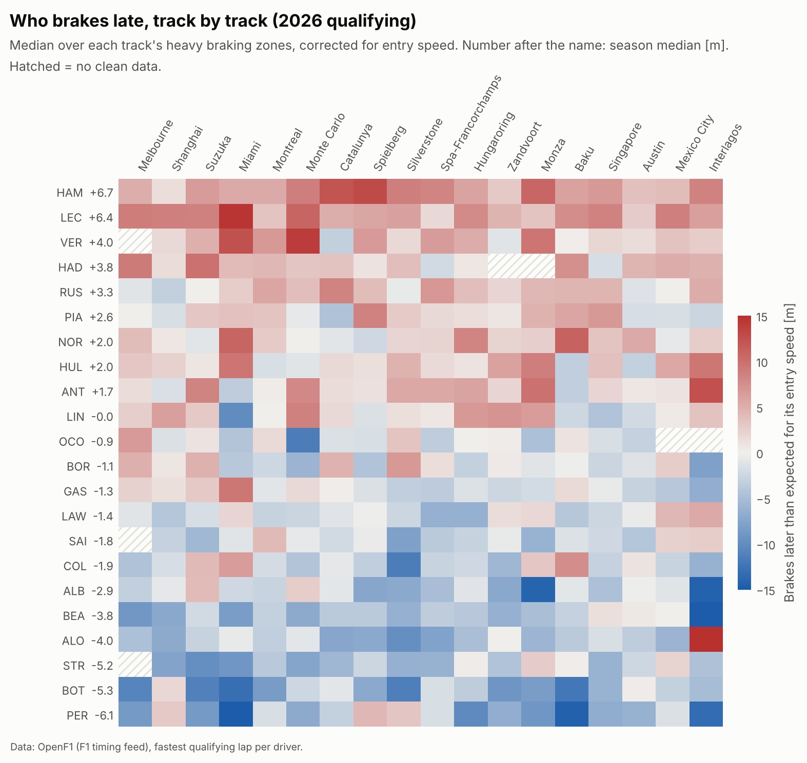

## Races

### On Sunday the field brakes about 14 m earlier

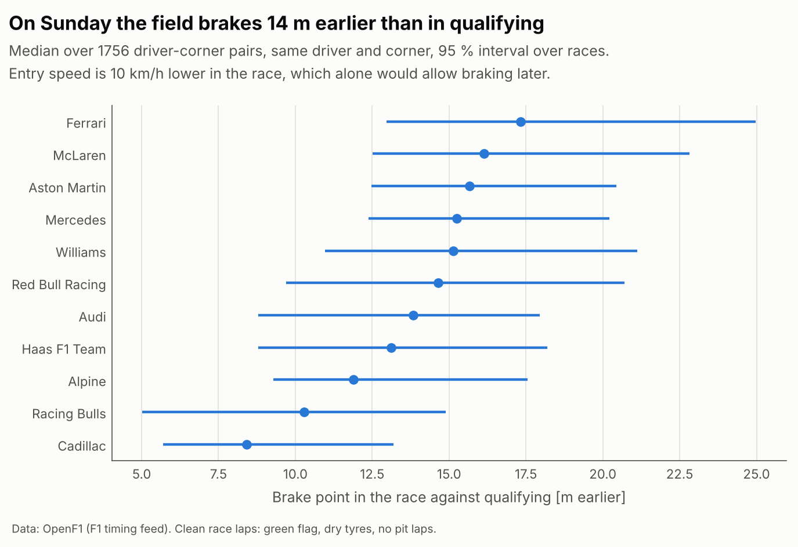

Same driver, same corner: the median race brake point is 13.8 m before the
qualifying one (95 % interval over races 11.5 to 17.5 m, 1756 driver-corner
pairs). Entry speed is 10 km/h lower in the race, which on its own would
allow braking later, and peak deceleration is 0.4 g lower. Teams range from
8 m (Cadillac) to 17 m (Ferrari); the intervals overlap, so the order
between teams is not established.

### Lift and coast belongs to the race, and to the power unit

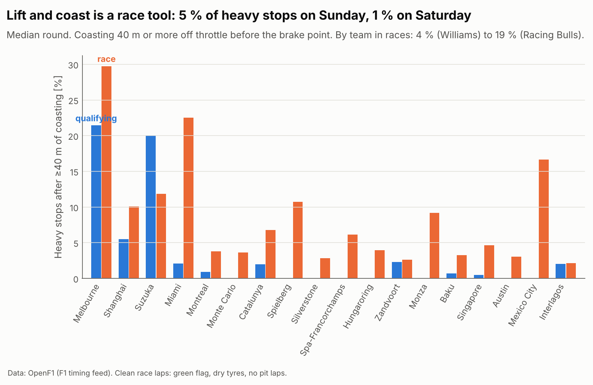

A stop counts as lift and coast when the car spends 40 m or more off
throttle before the brake point; shorter coasts cannot be told apart from
interpolation between 4 Hz samples. In the median round that is 5 % of
heavy stops in the race and under 1 % in qualifying. It peaks at Melbourne
(30 %), Miami (23 %) and Mexico City (17 %).

In qualifying it was common only at the start of the year: 21 % of heavy
stops at Melbourne and about a fifth at Suzuka, then under 3 % from Miami
on. That fits teams still learning to deploy the new power units over one
lap, though each of those tracks appears only once.

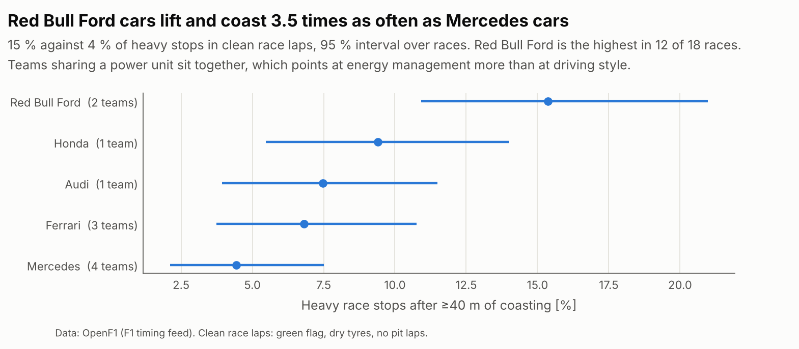

Grouped by power unit, the two Red Bull Ford teams lift and coast before
15 % of heavy race stops (interval 11 to 21 %) and the four Mercedes
powered teams before 4 % (2 to 8 %). Red Bull Ford is the highest in 12 of
18 races. Teams that share a power unit sit together, which points at
energy management more than at driving style. It does not say which
approach is faster.

### Old tyres cost corner speed, not brake point

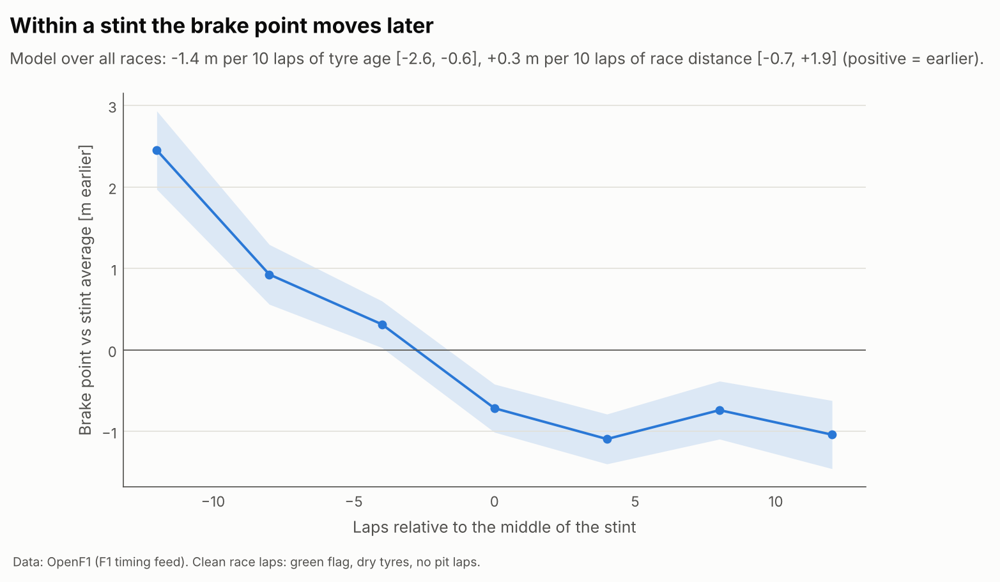

A model with tyre age and race distance, which pit stops allow to separate,
gives per 10 laps of tyre age: minimum speed −0.5 km/h (interval −0.9 to
−0.1) and the brake point 1.4 m later (0.6 to 2.6). Per 10 laps of race
distance, as fuel burns off: minimum speed +0.6 km/h and entry speed
+0.4 km/h, with no clear change in brake point. Drivers do not back the
brake point off as the tyres wear; the loss shows at the apex. Most of the
"later" happens in the first laps of a stint, when drivers brake early on
new tyres.

### Lap-to-lap scatter

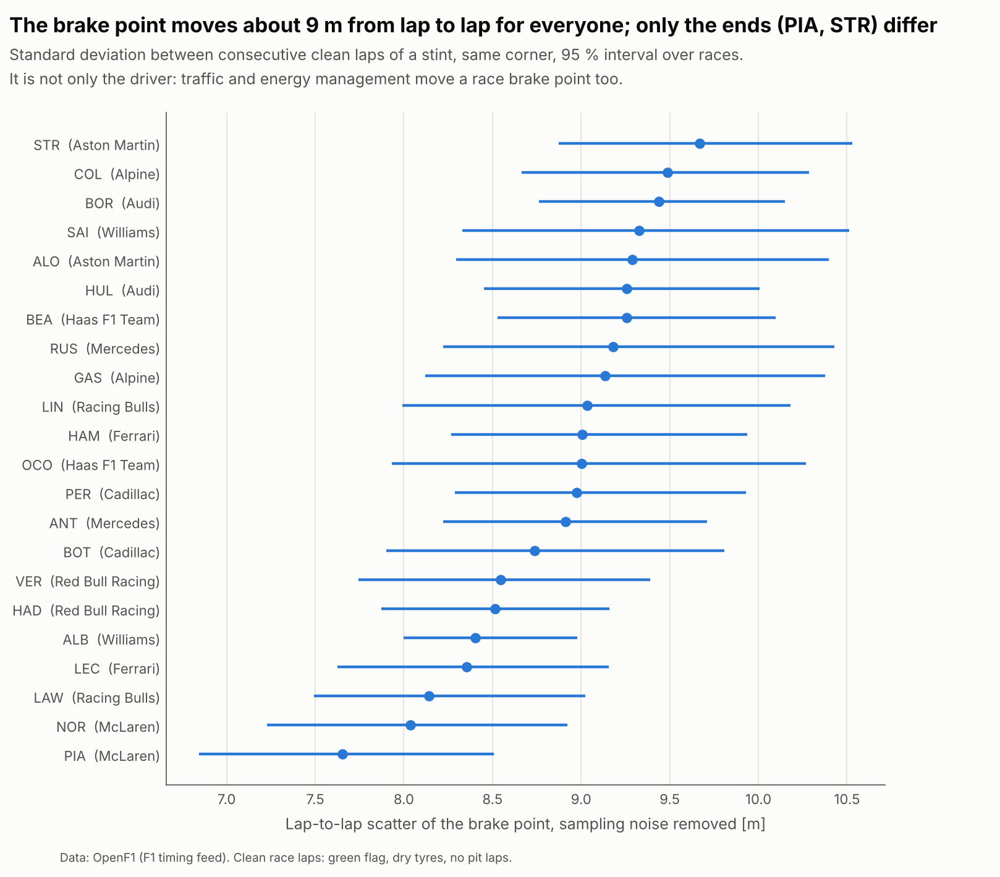

Between consecutive clean laps of a stint, the brake point at a given
corner moves with a standard deviation of 8.9 m once sampling noise is
removed (52 000 pairs of laps). Drivers range from 7.7 m (Piastri) to 9.7 m
(Stroll). Both McLarens are at the consistent end. Most of the field cannot
be separated: the intervals overlap. The number mixes the driver with
traffic and energy management, which move a race brake point too. Odometer error is not a large part: at Monza the result is the same for
the first corner of the lap and the last.

## What is not in here

- Hungaroring race: the feed has holes of about 1600 m per lap, so only 232
  laps survive the filters.
- Interlagos race: 453 laps on wet-weather tyres are excluded.
- Free air: race laps are not filtered by gap to the car ahead yet.
- One qualifying lap per driver, the fastest, which mixes Q1, Q2 and Q3
  track conditions.
- No brake pressure or steering in the feed, so nothing about trail braking.
